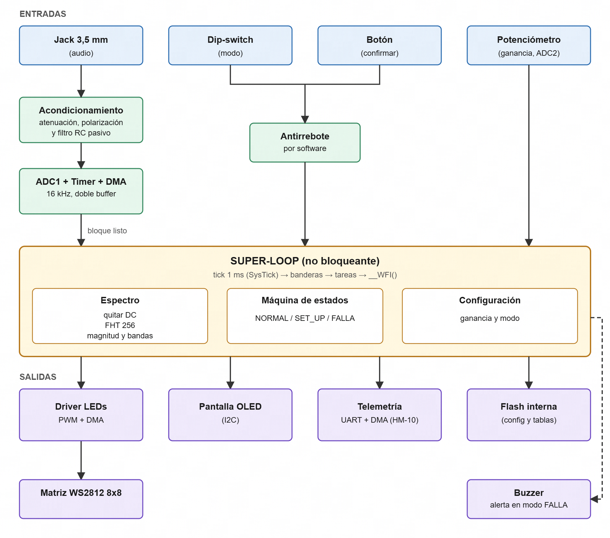

# FIUBA - Electrónica - Taller de Sistemas Embebidos - Trabajo Final - 2026-2doC 

# **Analizador de Espectro de Audio con FHT**

**Autores: Sorroza Fausto Esteban; Cingolani Camilo; Maizares Bruno**

**Padrones: *112909, 112744, 112959***

**Asignatura:** TA134 - Taller de Sistemas Embebidos

**Microcontrolador:** STM32F103RB (NUCLEO-F103RB)

**Fecha: 2do cuatrimestre 2026**

### **1. Selección del proyecto a implementar**

#### **1.1 Objetivo del proyecto y resultados esperados**

El objetivo del proyecto es diseñar e implementar un analizador de espectro de audio en tiempo real. Para ello, se capturará una señal mediante un conector Jack y se procesará digitalmente utilizando aritmética de punto fijo, debido a que el microcontrolador no cuenta con una unidad de punto flotante. El resultado se mostrará como barras de colores que representarán las distintas bandas de frecuencia en una matriz de LEDs RGB de 8x8, con un rango aproximado de 0 a 8 kHz.

Se buscará que el procesamiento sea lo suficientemente eficiente para que el Super-Loop complete cada ciclo en menos de 1 ms, sin utilizar código bloqueante. El sistema también contará con una interfaz local mediante una pantalla OLED, dip-switches, un botón y un potenciómetro, además de permitir guardar la configuración en memoria flash y transmitir información por Bluetooth.

Se implementarán tres modos de funcionamiento (NORMAL, SET_UP y FALLA), junto con un menú interactivo. Como funcionalidades adicionales, se buscará incorporar distintos modos de visualización, filtros digitales y opciones de ecualización seleccionables mediante dip-switches.

#### **1.2 Proyectos similares**

Se consideran tres proyectos posibles que resuelven el mismo problema, que es mostrar en luces el espectro de una señal de audio:

1. **Analizador de espectro Avanzado con STM32F103**, con matriz de LEDs RGB 8x8, pantalla OLED, Bluetooth y configuración guardada en memoria.
2. **Analizador de espectro Básico tipo Arduino**, matriz de LEDs de un solo color, sin menú ni funciones extra.
3. **Analizador de espectro con filtros analógicos**, con un filtro por cada banda de frecuencia que enciende una columna de LEDs, sin procesamiento digital.

Para comparar estas alternativas, se tienen en cuenta seis aspectos característicos:

1. **Disponibilidad del hardware:** Se evalúa si el proyecto es fácilmente implementable con componentes que se consigan en Argentina.
2. **Atractivo visual e interfaz:** Se refiere a qué tan vistoso resulta el analizador y qué tan cómodo es de configurar para el usuario.
3. **Aprovechamiento técnico:** Se entiende como cuánto se aprende y se desarrolla por cuenta propia en el proyecto.
4. **Tiempo de implementación:** Tiempo total que llevará diseñar, armar, programar y probar el proyecto dentro del cuatrimestre. A mayor puntaje, menos tiempo.
5. **Costo:** El costo total del proyecto, incluyendo la placa, la matriz de LEDs, la pantalla y el resto de los componentes. A mayor puntaje, más barato.
6. **Interés personal:** El grado de motivación del grupo para desarrollar el proyecto.

Se decide ponderar los aspectos de la siguiente manera, del 1 al 10:

- Disponibilidad del hardware: 10
- Atractivo visual e interfaz: 8
- Aprovechamiento técnico: 6
- Tiempo de implementación: 8
- Costo: 5
- Interés personal: 8

La disponibilidad del hardware es lo más importante, ya que se busca trabajar con componentes fáciles de conseguir; por eso se asigna un peso 10. El atractivo visual y el tiempo de implementación valen 8, porque se quiere un proyecto vistoso que se pueda terminar dentro del cuatrimestre. El aprovechamiento técnico recibe un 6: es deseable aprender, pero primero se prioriza tener un prototipo que funcione. El costo tiene un peso 5, ya que no se busca gastar lo mínimo posible sino hacer un buen proyecto. Por último, el interés personal se valora con 8 porque se quiere hacer algo que motive al grupo.

La siguiente tabla (Tabla 1.2.1) muestra los valores ponderados asignados a cada proyecto considerado.

<table>
    <thead>
        <tr>
            <th rowspan="2">Proyecto</th>
            <th colspan="2">Analizador avanzado STM32 (matriz RGB, OLED, Bluetooth)</th>
            <th colspan="2">Analizador básico Arduino (matriz de un color)</th>
            <th colspan="2">Analizador con filtros analógicos</th>
        </tr>
        <tr>
            <th>Puntaje</th>
            <th>Puntaje Ponderado</th>
            <th>Puntaje</th>
            <th>Puntaje Ponderado</th>
            <th>Puntaje</th>
            <th>Puntaje Ponderado</th>
        </tr>
    </thead>
    <tbody>
        <tr class="header-row">
            <td align ="center">Disponibilidad de Hardware  (peso : 10)</td>
            <td>8</td>
            <td>80</td>
            <td>10</td>
            <td>100</td>
            <td>8</td>
            <td>80</td>
        </tr>
        <tr>
            <td align ="center">Atractivo visual e interfaz  (peso : 8)</td>
            <td>10</td>
            <td>80</td>
            <td>5</td>
            <td>40</td>
            <td>6</td>
            <td>48</td>
        </tr>
        <tr class="header-row">
            <td align ="center">Aprovechamiento técnico  (peso : 6)</td>
            <td>10</td>
            <td>60</td>
            <td>5</td>
            <td>30</td>
            <td>4</td>
            <td>24</td>
        </tr>
        <tr>
            <td align ="center">Tiempo de Implementación  (peso : 8)</td>
            <td>6</td>
            <td>48</td>
            <td>9</td>
            <td>72</td>
            <td>5</td>
            <td>40</td>
        </tr>
        <tr class="header-row">
            <td align ="center">Costo (peso : 5)</td>
            <td>5</td>
            <td>25</td>
            <td>9</td>
            <td>45</td>
            <td>7</td>
            <td>35</td>
        </tr>
        <tr>
            <td align ="center">Interés personal  (peso : 8)</td>
            <td>10</td>
            <td>80</td>
            <td>5</td>
            <td>40</td>
            <td>4</td>
            <td>32</td>
        </tr>
        <tr class="highlight-green">
            <td>Puntaje Total</td>
            <td>-</td>
            <td>373</td>
            <td>-</td>
            <td class="highlight-red">327</td>
            <td>-</td>
            <td>259</td>
        </tr>
    </tbody>
</table>

<em>Tabla 1.2.1: Comparación de proyectos</em>

#### **1.3 Selección de proyecto**

Vistas las consideraciones tomadas en cuenta para elegir el proyecto a desarrollar, se decidió seguir adelante con el analizador de espectro avanzado con STM32F103RB. A diferencia de las otras opciones, esta aprovecha mucho más la placa y ofrece una visualización más completa. Si bien el analizador básico es más barato y fácil de implementar, cuenta con una matriz de un solo color, por lo que su resultado es muy básico y nos resulta menos atractivo. El de filtros analógicos, por su parte, no necesita programación, pero sus bandas son fijas y se aprende poco sobre sistemas embebidos, por lo que no justifica el tiempo que lleva armarlo.

De esta forma, el proyecto consiste en un analizador de espectro de audio en tiempo real que muestra las frecuencias, de 0 a 8 kHz, como barras de colores en una matriz de LEDs RGB WS2812 de 8x8. Para lograrlo, se utilizará el ADC de la placa para tomar 256 muestras, las cuales serán enviadas a procesar por DMA  y se les aplicará una Transformada Rápida de Hartley (FHT) de 256 puntos en punto fijo, ya que el microcontrolador no tiene unidad de punto flotante. El sistema se maneja con una pantalla OLED, dip-switches, un botón y un potenciómetro para ajustar la ganancia, y cuenta con tres modos de funcionamiento: NORMAL, SET_UP y FALLA. Además, guarda su configuración en la memoria flash y puede enviar información por Bluetooth.
Como prueba de viabilidad, se midió en la placa el núcleo del procesamiento (FHT y cálculo de magnitudes) simulando en la entrada una señal con ruido y el procesamiento tardó unos 335 µs. Todavía falta sumar el resto de las tareas,las cuales resultan menos caras temporalmente, por lo que el límite de 1 ms por ciclo del Super-Loop se verificará durante la implementación.

Los principales desafíos que se van a afrontar son lograr que todo el sistema funcione en menos de 1 ms por ciclo sin código bloqueante, diseñar bien la etapa analógica de entrada (polarización y filtro) y repartir los canales de DMA y las interrupciones sin conflictos.

#### 1.4 Diagrama en bloques

<em>Figura 1: Diagrama en Bloques del proyecto</em>

En la Figura 1 se presenta el diagrama en bloques del proyecto, el cual se separa en las 3 etapas esperadas, Escrutar/Procesar/Actuar:

- Escrutar: Entradas analógicas del sistema, como la señal de audio entrante por el jack de 3,5 mm junto con los sensores para ajustar parámetros a guardar en el modo SET_UP, como los dip switches para cambiar de modo (NORMAL, SET_UP), el botón de confirmación del modo seleccionado y un potenciómetro para ajustar la ganancia de las bandas.

- Procesar: Super-Loop de 1ms en el cual debe caber todo el procesamiento, como el cálculo del espectro de la señal utilizando el algoritmo DHT (junto con el cálculo de las magnitudes y su agrupamiento por bandas), el filtrado antirrebote del botón de confirmación, las maquinas de estado para cada modo de operación (NORMAL, SET_UP, FALLA), la persistencia de la configuración elegida por el ususario, y las rutinas de interrupción por DMA tanto para el buffer lleno como para el control de la matriz LED. 

- Actuar: Las salidas del sistema, como la matriz LED para visualizar el espectro de las eñal de entrada, la pantalla OLED para visualización de la configuración/modo de operación, la comunicación del módulo Bluetooth con la aplicación vía UART + DMA y el buzzer para indicar el modo FALLA.

#### 1.5 Análisis de Viabilidad

Para evaluar la viabilidad de la propuesta se implementó el algoritmo de la Transformada Rápida de Hartley (FHT) y se midieron sus tiempos de ejecución, con el objetivo de verificar que el procesamiento sea compatible con la condición del SuperLoop y deje margen suficiente para el resto de las tareas del sistema.

### Primeras implementaciones

Los primeros intentos arrojaron tiempos elevados: algunos no cumplían la condición del SuperLoop y otros dejaban muy poco margen para procesar otras tareas (alrededor de 0,2 ms). A medida que se analizó en detalle cada etapa del algoritmo (inversión de índices, cálculo de las mariposas y obtención de las magnitudes del espectro) fue posible identificar los puntos críticos y optimizarlos.

### Metodología de las pruebas

Para las pruebas se generó un arreglo de 256 muestras con valores aleatorios, simulando el muestreo de una señal con ruido (de modo que casi todas las frecuencias tengan magnitud distinta de cero). Sobre este arreglo se aplicó la FHT junto con el cálculo de las magnitudes. Se registraron las siguientes variables:

- `ciclos_totales`: ciclos de reloj consumidos por el procesamiento completo.
- `tiempo_dht_us`: tiempo, en microsegundos, de la FHT únicamente (inversión de índices y mariposas).
- `tiempo_total_us`: tiempo, en microsegundos, de la FHT más el cálculo de las magnitudes.

### Caso 1: señal con ruido y cálculo de magnitud exacto

| Variable | Valor |
|---|---|
| `ciclos_totales` | 40781 |
| `tiempo_dht_us` | 285,47 µs |
| `tiempo_total_us` | 566,40 µs |

### Caso 2: señal con ruido y magnitud aproximada

| Variable | Valor |
|---|---|
| `ciclos_totales` | 24147 |
| `tiempo_dht_us` | 285,47 µs |
| `tiempo_total_us` | 335,38 µs |

### Análisis de resultados

Al comparar ambos casos, el tiempo de la FHT es idéntico (285,47 µs), mientras que el tiempo total varía en 0,231 ms. Esto indica que el cálculo de los valores absolutos del espectro es una de las etapas más costosas del procesamiento. Las magnitudes de la FHT se obtienen como:

<em>Figura 2: Magnitud exacta FHT</em>

Con 256 muestras, el algoritmo debe calcular 128 raíces cuadradas sin FPU, lo que aumenta de forma significativa el tiempo de procesamiento.

El cuello de botella no está en la FHT en sí, sino en el cálculo exacto de las magnitudes, que requiere 128 raíces cuadradas sin FPU y eleva el tiempo total a 40781 ciclos (0,566 ms). Reemplazarlo por la aproximación reduce el tiempo total en aproximadamente un 41 % sin afectar el objetivo de visualización, ya que la matriz LED RGB de 8x8 solo representa 8 niveles de "volumen" y el error de la aproximación resulta imperceptible.

Dado que el microcontrolador ya opera a su frecuencia máxima, no existe margen adicional por aumento de reloj; por ello, las optimizaciones a nivel algorítmico, como la aproximación de magnitudes, son las que permiten asegurar la viabilidad del procesamiento en tiempo real.

### Optimización mediante Alpha Max Beta Min

Al identificar que el cálculo de las magnitudes tiene un peso importante en el tiempo total, se evaluó prescindir de las magnitudes exactas y se probó el algoritmo **Alpha Max Beta Min**, que aproxima la raíz cuadrada de una suma de cuadrados sin necesidad de calcularla. Esta aproximación permitió reducir el tiempo total a 0,335 ms (Caso 2), lo que equivale a una reducción de aproximadamente el 41 % respecto del cálculo exacto (0,566 ms), y de los ciclos consumidos de 40781 a 24147.

El costo de esta optimización es un error de aproximación que depende de la fase entre H[k] y H[N-k]. Se considera que este error no es relevante para la propuesta, ya que el espectro de la señal de entrada se mostrará en una matriz LED RGB de 8x8, por lo que solo se contará con 8 niveles de "volumen" y la diferencia resulta imperceptible en la visualización.

### Conclusión

Las pruebas se realizaron con el microcontrolador funcionando a su frecuencia máxima de 72 MHz. En esas condiciones, la FHT de 256 muestras resulta viable para la propuesta: la transformada (inversión de índices y mariposas) se ejecuta en 285,47 µs, equivalentes a unos 20.550 ciclos de reloj. Al sumar el cálculo de las magnitudes mediante Alpha Max Beta Min, el procesamiento completo toma 24147 ciclos, es decir, 0,335 ms. Esto compatibiliza el algoritmo con la condición del SuperLoop y deja margen para el resto de las tareas del sistema.

### **2. Elicitación de requisitos y casos de uso**

En Argentina se consiguen productos que muestran el espectro de un audio, pero en general son equipos o kits cerrados, con funciones fijas y sin posibilidad de modificarlos.

Como primer competidor están los analizadores de espectro de consumo, como el [Nobsound AK2515 Pro](https://www.fravega.com/p/nobsound-ak2515-pro-analizador-de-espectro-de-audio-con-pa-22786016/), que se vende en Frávega. Tiene una pantalla VFD, entrada de micrófono y control automático de ganancia, pero cuesta bastante más que este proyecto. Además, es un producto cerrado: no se puede cambiar cómo procesa ni cómo muestra el sonido, y no tiene telemetría. Nuestro proyecto se diferencia por usar una matriz RGB con un color por banda, por guardar la ganancia aunque se apague, por enviar datos por Bluetooth y por tener un firmware que se puede modificar.

Como segundo competidor están los kits de LEDs para armar, como el [KS25](https://desertcart.com.ar/products/210102893-txyfyp-music-for-spectrum-ks-25-music-audio-for-spectrum-analyzer-kit-led-fantasy-crystal-cube-level-display-for-audio-system-vacuum-tube-amplifier-diy), y las tiras LED que reaccionan al sonido, como la [Monster LED](https://desertcart.com.ar/products/456129042-monster-led-6-5-ft-indoor-light-strip-sound-reactive-lights-multi-color-usb-powered). Se consiguen importados a través de desertcart y son baratos, pero casi todos usan electrónica analógica o simplemente reaccionan al ruido ambiente. No tienen menú, no guardan configuración y no permiten tocar el firmware.

En resumen, hay muchos productos para ver el espectro de un audio, pero ninguno de los que encontramos junta en un solo equipo abierto el procesamiento digital, la matriz de colores, un menú configurable y la conexión por Bluetooth. Además, como usa módulos fáciles de conseguir en el país (matriz WS2812, OLED y HM-10), es simple de armar y de reparar.
#### **2.1 Requisitos del proyecto**

En la Tabla 2.1 se detallan los requisitos del proyecto, agrupados por función.

| Grupo | ID | Descripción |
| :---- | :---- | :---- |
| Captura de audio | 1.1 | El sistema capturará audio desde un conector Jack de 3,5 mm, con acople, polarización y protección de la entrada. |
|  | 1.2 | Un filtro pasabajos RC de primer orden limitará el aliasing antes del ADC. |
|  | 1.3 | El muestreo será continuo, a 16 kHz, con el ADC disparado por un timer y los datos transferidos por DMA a un doble buffer (tamaño para 256 muestras c/u). |
| Procesamiento | 2.1 | El sistema calculará una FHT de 256 puntos en aritmética de punto fijo. |
|  | 2.2 | El sistema agrupará el espectro de 0 a 8 kHz en 8 bandas y cuantizará cada una a 8 niveles en escala logarítmica. |
|  | 2.3 | La ganancia ajustada con el potenciómetro se aplicará antes de cuantizar. |
| Visualización | 3.1 | El sistema mostrará el espectro como 8 barras de colores en una matriz WS2812 de 8x8. |
|  | 3.2 | El envío de datos a la matriz se hará mediante timer PWM con DMA, sin esperas bloqueantes. |
|  | 3.3 | El brillo máximo de la matriz estará limitado para acotar el consumo de corriente. |
| Interfaz local | 4.1 | Una pantalla OLED (I2C) mostrará el estado y los menús, y se actualizará sin bloquear el sistema. |
|  | 4.2 | Un potenciómetro permitirá ajustar la ganancia. |
|  | 4.3 | Los dip-switches permitirán alternar entre los modos NORMAL y SET_UP, y un botón confirmará las selecciones. |
|  | 4.4 | El botón y los dip-switches tendrán antirrebote por software, sin esperas bloqueantes. |
| Persistencia | 5.1 | El sistema guardará la ganancia y el modo en la flash interna, únicamente desde el modo SET_UP. |
|  | 5.2 | Al encender, el sistema cargará la configuración guardada en la flash. |
| Telemetría | 6.1 | El sistema enviará por UART con DMA, hacia el módulo Bluetooth HM-10, una línea de texto con la frecuencia pico y el modo de operación. |
|  | 6.2 | Los datos podrán verse en un celular mediante una aplicación de terminal Bluetooth. |
| Alertas | 7.1 | Si la entrada satura, el sistema pasará al modo FALLA, activará un buzzer y mostrará un aviso en el OLED. |
|  | 7.2 | El sistema volverá al modo NORMAL cuando la señal deje de saturar. |
| Arquitectura | 8.1 | El sistema será bare metal (sin sistema operativo), con un Super-Loop cuya vuelta dure menos de 1 ms. |
|  | 8.2 | El tick de 1 ms se generará con el SysTick, y su callback solo levantará flags. |
|  | 8.3 | El código será modular, con tareas no bloqueantes. |
|  | 8.4 | El sistema ejecutará `__WFI()` al terminar la vuelta cuando no haya trabajo pendiente. |

<em>Tabla 2.1: Requisitos del proyecto</em>

#### **2.2 Caso de uso 1: El usuario visualiza el espectro de una canción**

En la Tabla 2.2 se describe el primer caso de uso, el funcionamiento normal del sistema.

| Elemento | Definición |
| :---- | :---- |
| **Disparador** | El usuario reproduce música por la entrada de audio (Jack) y desea visualizar el espectro. |
| **Precondiciones** | El sistema está encendido y el dip-switch está en la posición del modo NORMAL. |
| **Flujo principal** | El ADC muestrea de forma continua y, al completarse cada bloque, el callback del DMA avisa a la CPU para comenzar el procesamiento. El Super-Loop calcula la FHT y las magnitudes, las agrupa en 8 bandas, arma la trama con ayuda de las tablas en flash y ordena al DMA enviarla a la matriz WS2812. El OLED muestra el estado del sistema y el módulo Bluetooth envía la frecuencia de mayor energía a la aplicación del usuario. |
| **Flujos alternativos** | a. La entrada satura: el sistema pasa al modo FALLA (ver Tabla 2.4). |

<em>Tabla 2.2: Caso de uso 1: El usuario visualiza el espectro de una canción</em>

#### **2.3 Caso de uso 2: El usuario modifica y guarda la ganancia**

En la Tabla 2.3 se describe el segundo caso de uso, la configuración persistente de la ganancia.

| Elemento | Definición |
| :---- | :---- |
| **Disparador** | El usuario desea cambiar la ganancia de las barras y guardarla. |
| **Precondiciones** | El sistema opera en modo NORMAL y las barras quedan muy bajas porque la señal de audio es débil. |
| **Flujo principal** | El usuario cambia el dip-switch a la posición del modo SET_UP. El análisis se pausa y el OLED muestra el menú de ajustes. El usuario gira el potenciómetro hasta alcanzar la ganancia deseada y presiona el botón de confirmación, y el sistema guarda el valor en la flash interna. Al devolver el dip-switch a la posición del modo NORMAL, el análisis se reanuda con la nueva ganancia. |

<em>Tabla 2.3: Caso de uso 2: El usuario modifica y guarda la ganancia</em>

#### **2.4 Caso de uso 3: La entrada de audio satura**

En la Tabla 2.4 se describe el tercer caso de uso, la detección de saturación de la entrada.

| Elemento | Definición |
| :---- | :---- |
| **Disparador** | El usuario sube el volumen de la fuente y la señal supera el rango del ADC (clipping). |
| **Precondiciones** | El sistema opera en modo NORMAL y hay una fuente de audio conectada. |
| **Flujo principal** | El sistema detecta muestras en los extremos del rango del ADC. Pasa al modo FALLA, activa el buzzer y muestra un aviso de saturación en el OLED. Cuando el usuario baja el volumen y la señal vuelve al rango normal, el sistema retorna al modo NORMAL. |
| **Flujos alternativos** | a. El usuario cambia el dip-switch a SET_UP durante la falla: el sistema atiende el modo SET_UP. |

<em>Tabla 2.4: Caso de uso 3: La entrada de audio satura</em>

