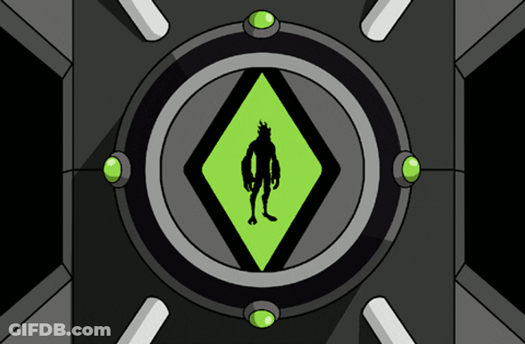

**1. Selección del proyecto a implementar**

*1.1 Objetivo del proyecto*

El objetivo de este proyecto es diseñar e implementar un sistema embebido interactivo en donde buscamos implementar un juguete basado en el reloj "omnitrix" de la serie para niños Ben 10, en donde el protagonista tiene un reloj con el que gira un dial para intercambiar en que alienigena convertirse al presionarlo. El sistema integrará diversos periféricos de entrada/salida para navegar menús, rotar entre los diferentes aliens, reproducir secuencias visuales y emitir sonidos mediante eventos temporizados, y comunicarse con una aplicación móvil que actuará como panel de estado, mostrando datos y trivia del alien seleccionado, permitiendo desbloquear más personajes contestando preguntas de datos de la serie. Todo el procesamiento se realizará bajo un patrón de diseño de software no bloqueante (Super-loop), respetando las limitaciones arquitectónicas del microcontrolador.

 

*1.2 Proyectos similares analizados*

Antes de decidir que proyecto llevar a cabo, evaluamos otro posible proyecto, se evaluaron tres alternativas considerando los requisitos de la cátedra y las limitaciones de hardware (Cortex-M3 sin FPU/DSP):

Analizador de Espectro de Audio FFT: Captura de audio analógico y cálculo de Transformada Rápida de Fourier para controlar tiras LED, similar al que se ve en los equipos de música (estereo), pero con perfiles personalizables y múltiples entradas.

Omnitrix Interactivo (Seleccionado): Dispositivo de entretenimiento (juguete) con interfaz física (dial analógico, botones), display LED, efectos de luces/sonido y conexión Bluetooth.

A continuación se adjunta una pequeña tabla de análisis de riesgos para estos proyectos.

| Criterio | Analizador Espectro FFT | Omnitrix Interactivo |
| :--- | :---: | :---: |
| **Uso óptimo de CPU (Cortex-M3)** | Bajo (Riesgo de bloqueo) | Alto |
| **Cumplimiento de requisitos obligatorios** | Medio | Alto |
| **Interés del grupo** | Alto | Alto |
| **Viabilidad técnica** | Baja (Falta de DSP) | Alta |

Si bien nos interesaba mucho el proyecto del Analizador de Espectro, notamos que podríamos exceder los límites de hardware de nuestro microprocesador, no pudiendo completar todo lo necesario en 1 ms. Esto último debido a que al carecer de una únidad de cálculo de punto flotante dedicada, es muy dificil efectuar una FFT sin que esta demande demasiado poder de procesamiento.

En cuanto a disponibilidad de hardware o costo del mismo no debería de ser un impedimento para la implementación del proyecto, puesto que el componente más caro en un principio sería el display en donde se mostrarán los alienigenas.

## 1.3 Selección y Justificación
Se selecciona el **Omnitrix Interactivo** dado que permite cumplir con la totalidad de los requisitos obligatorios de hardware (ADC, I2C/SPI, Bluetooth, etc) sin comprometer el factor de uso de la CPU. Al basarse en máquinas de estado y eventos temporizados en lugar de calculos matemáticos intensivos, asegura que las iteraciones del ejecutor cíclico se mantengan  por debajo de 1 ms.

# 2. Elicitación de requisitos y casos de uso

## 2.1 Requisitos Relevantes
**Requerimientos Funcionales:**
*   **RF1:** El sistema permitirá navegar un menú de selección de personajes utilizando un potenciómetro como dial giratorio.
*   **RF2:** El sistema mostrará las opciones disponibles en un display (I2C/SPI).
*   **RF3:** Al confirmar una selección mediante un pulsador, el sistema ejecutará una secuencia de luces (LEDs) y sonido (Buzzer).
*   **RF4:** El sistema guardará los personajes desbloqueados en la memoria EEPROM.
*   **RF5:** Una aplicación móvil conectada vía HM-10 (BLE) permitirá visualizar el estado actual del dispositivo (personaje activo), y visualizar trívia del personaje, así como contestar preguntas para desbloquear otros personajes.

**Requerimientos No Funcionales:**
*   **RNF1:** El muestreo del dial analógico se realizará mediante ADC, preferentemente utilizando DMA.
*   **RNF2:** El software utilizará una arquitectura Super-loop no bloqueante.
*   **RNF3:** Ante una falla de comunicación (ej. pérdida de conexión I2C con el display), el sistema pasará a estado de FALLA y lo indicará visual (con el display) y sonoramente (con el buzzer).

**Caso de Uso 1: Selección y Transformación**
1. El usuario gira el potenciómetro (dial).
2. El sistema lee el valor analógico y actualiza el display mostrando diferentes personajes.
3. El usuario presiona el botón "Confirmar".
4. El sistema bloquea temporalmente el cambio de personajes, emite una secuencia de tonos en el buzzer y hace titilar los LEDs.
5. El sistema envía el ID del personaje seleccionado a la App móvil vía Bluetooth.
*Excepción:* Si el usuario presiona el botón de "Cancelar", el dispositivo vuelve al estado de reposo.

**Caso de Uso 2: Configuración del dispositivo (SET_UP)**
1. El usuario acciona un canal del Dip Switch físico para poner el dispositivo en modo SET_UP.
2. El sistema detiene el funcionamiento normal y el display muestra un menú de configuración (ej. "Brillo", "Volumen", "Borrar Memoria").
3. El usuario navega con el dial (potenciómetro) hasta la opción "Borrar Memoria" (para bloquear de nuevo todos los aliens) y presiona el botón para confirmar.
4. El sistema sobreescribe la memoria EEPROM borrando el progreso, y emite un tono de confirmación con el buzzer.
5. El usuario desactiva el Dip Switch y el sistema retorna automáticamente a su estado NORMAL.

**Caso de Uso 3: Alerta de falla de periféricos**
1. Durante la inicialización o ejecución, el sistema detecta que el display I2C no responde (timeout).
2. El sistema cambia automáticamente a la máquina de estados de FALLA.
3. El buzzer emite un tono de error continuo e intermitente, y un LED rojo parpadea rápidamente.
4. El sistema espera un reinicio manual (Reset).

**Caso de Uso 4: Desbloqueo de nuevo personaje vía Bluetooth**
1. El usuario está jugando en la aplicación móvil y contesta correctamente una trivia sobre la serie.
2. La app envía un comando específico (trama de datos) por Bluetooth (HM-10) al microcontrolador.
3. El sistema recibe el comando de forma no bloqueante por UART, procesa el ID del nuevo alien y lo guarda en la memoria externa EEPROM para que persista.
4. El dispositivo interrumpe brevemente el menú, reproduce una animación de "Desbloqueado" en el display y emite un sonido de victoria.
5. El nuevo alienigena queda disponible para ser seleccionado al girar el dial.

